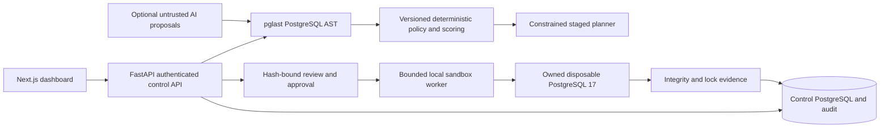

# SchemaShield architecture

SchemaShield separates analysis, authorization, and execution. PostgreSQL 17 is the supported runtime baseline. Unknown schema cardinality, dependencies, casts, defaults, versions and application usage remain conservative risk evidence.

## Component contracts
`POST /api/migrations` accepts bounded title and SQL; returns ID, immutable SHA-256 content hash, operations, findings, score, decision and policy version. `GET /api/migrations` returns history; `GET /api/migrations/{id}` returns full analysis and associated evidence. `POST /api/migrations/{id}/plan` derives a constrained plan. `POST /api/migrations/{id}/validate` validates eligible SQL in an owned sandbox. Approval and execution must require successful evidence tied to the same artifact digest. Health reports process liveness; readiness checks control persistence separately from sandbox capability.

Persistence contains migration records (UUID, SQL/hash, analysis JSON, created timestamp), plans (immutable JSON and digest), validation reports (artifact digest, environment/version, fixture digest, measured outcomes), approval records (digest/evidence/reviewer) and append-only application audit events. Backfill checkpoints must commit with backfill writes inside the disposable database. API request bodies never contain execution DSNs.

## Threat model and boundaries
- Untrusted SQL can invoke arbitrary routines, use COPY PROGRAM, create extensions, access filesystem/network, exhaust CPU/storage or escape through privileged functions. AST allowlists and an unprivileged database role deny these operations; disposable execution is defense in depth.
- Control credentials and Docker access are privileged. Browser never accesses them. Owned-container labels, loopback port binding, dropped capabilities, memory/CPU/pid limits and lifetime limits constrain workers. Docker is local trusted infrastructure, not a hostile multitenant security boundary.
- Approval replay, artifact edits, concurrent jobs and stale tests require hashes, durable state transitions and atomic compare-and-set updates.
- Runtime tests on fixtures cannot prove production compatibility or absence of locks. Reports distinguish predicted risks from observations. Contract steps require external application cutover evidence and explicit human approval.
- Partial autocommit migrations can leave changes committed. Record executed steps and retain report; destroy sandbox after reporting. Do not promise inverse-DDL recovery.

## SQL and transaction semantics
AST-supported statements may still be disallowed for execution when child expressions are unsafe. Concurrent indexes require autocommit and separate statements. ALTER TABLE operations can require ACCESS EXCLUSIVE even when metadata-only. NOT VALID reduces initial constraint scan scope; VALIDATE still consumes resources. Backfills must not use offset pagination; bounded primary-key processing and final consistency verification address interruption and concurrent mutation.

## Implemented persistence and execution lifecycle

SQLAlchemy/Alembic maintain four control tables: `migrations` (source/hash/analysis/derived plan), `jobs` (artifact/target/kind/status/report/cancellation), `approvals` (reviewer/hash/report/consumed), and `audit` (event/subject/details/time). IDs are UUID strings. Application audit routes only append/read events; privileged database administration remains outside that guarantee. The plan is stored on its migration, not in a separate table.

Job transitions are queued → running → passed/failed/cancelled. Restart recovery fails interrupted jobs and records audit events rather than replaying them. A session-held PostgreSQL advisory lock enforces one active API worker per control database, while a transaction advisory lock serializes enqueues globally and atomic approval consumption prevents replay. A second worker cannot recover another worker's live jobs. SQLite is explicitly opt-in development storage and does not provide PostgreSQL acceptance.

The lease is checked before protected requests and worker execution boundaries. Losing its connection or lock fails readiness and protected APIs closed until process restart; interrupted workers cannot publish a successful report. Already-running SQL remains bounded by its statement/environment deadline and may be partially committed. Integration terminates the lease backend to verify fail-closed behavior and replacement-worker ownership.

Every validation/approval/execution regenerates analysis and checks versions and hashes. Plans are regenerated and compared before execution. Manual application handoffs and all CONTRACT steps are rejected for automatic execution. Validation itself runs before approval to collect evidence; controlled execution requires passing checks, matching report/artifact/plan hashes, a report no older than one hour, and an unused human approval. Each operation uses another fresh fixture, never a previous environment or control database.

SQL is limited to 100,000 UTF-8 bytes and HTTP bodies to 120,000 bytes with a five-second streaming deadline. The restricted AST execution subset rejects routines, transaction wrappers, unsupported operators/types, cross-database/system-schema objects, conditional DDL without definition evidence and value-changing FK actions. Runtime limits are 1 CPU, 384 MiB RAM, 80 PIDs, 192 MiB PostgreSQL tmpfs, 12 connections, 1-second lock timeout, 5-second statement timeout and a default 90-second environment lifetime (configured range 10..300). Default active jobs: two. Expired resources are reaped only when both ownership identity and lease match.

The approved deployment runs the API inside a trusted container with local Docker orchestration access, temporarily joining each execution database's internal network. The database and browser have no Docker socket or source mount. The host loopback transport cannot publish PostgreSQL ports on the inspected engine's internal networks; static host development keeps runtime disabled. Production Next builds run as the nonroot node user. Control PostgreSQL storage is separate from disposable execution tmpfs.

## API surface

| Route | Behavior |
|---|---|
| GET `/health`, `/ready` | Process health; real control persistence readiness |
| GET `/api/capabilities` | Persistence, sandbox and AI capability; production execution always false |
| POST/GET `/api/migrations` | Analyze/persist bounded SQL; retrieve history |
| GET `/api/migrations/{id}` | Source, analysis, plan, reports and approvals |
| POST `/api/migrations/{id}/plan` | Deterministic derived alternative with digest |
| POST `/api/migrations/{id}/validate` | Queue eligible migration or plan in owned environment |
| POST `/api/migrations/{id}/approve` | Human review bound to passing report/hash |
| POST `/api/migrations/{id}/execute` | Consume approval; execute fresh disposable fixture |
| POST `/api/migrations/{id}/recommend` | Optional unverified AI proposals and deterministic reanalysis |
| POST `/api/migrations/{id}/backfill-demo` | Fixed reviewed interruption/reconnect demonstration |
| GET `/api/jobs`, `/api/jobs/{id}` | Job/report/progress status |
| POST `/api/jobs/{id}/cancel` | Durable cancellation flag, honored at bounded step boundaries |
| GET `/api/audit` | Authenticated event history |

All `/api` routes require the configured local bearer token. Execution request models forbid extra fields; callers cannot submit a connection URL, image, Docker option, host path or command. Provider credentials and submitted secrets are omitted from logs and errors. FastAPI OpenAPI publishes exact request schemas.

AI is opt-in through a bounded JSON gateway with separate provider credentials. Its proposals are labeled unverified, cannot call approval/execution, and proposed SQL is deterministically analyzed. Source comments/SQL are serialized as untrusted data. The complete deterministic workflow runs with AI disabled.

Scoring policy `score-1.0` starts at 100 (higher is safer), deducts 20 for missing runtime evidence, then the highest severity per category subject to documented caps and a zero floor. Contributions sum to 100 minus the score. A runtime report never retroactively makes a different source artifact safe. Policy `rules-1.1` and parser `pglast-v8.5/extractor-1.1` are recorded; changing versions invalidates old persisted artifacts.
