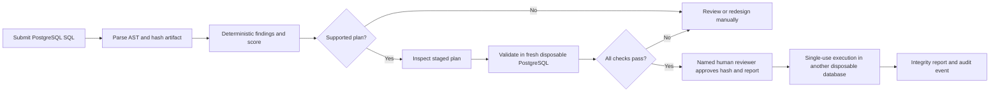
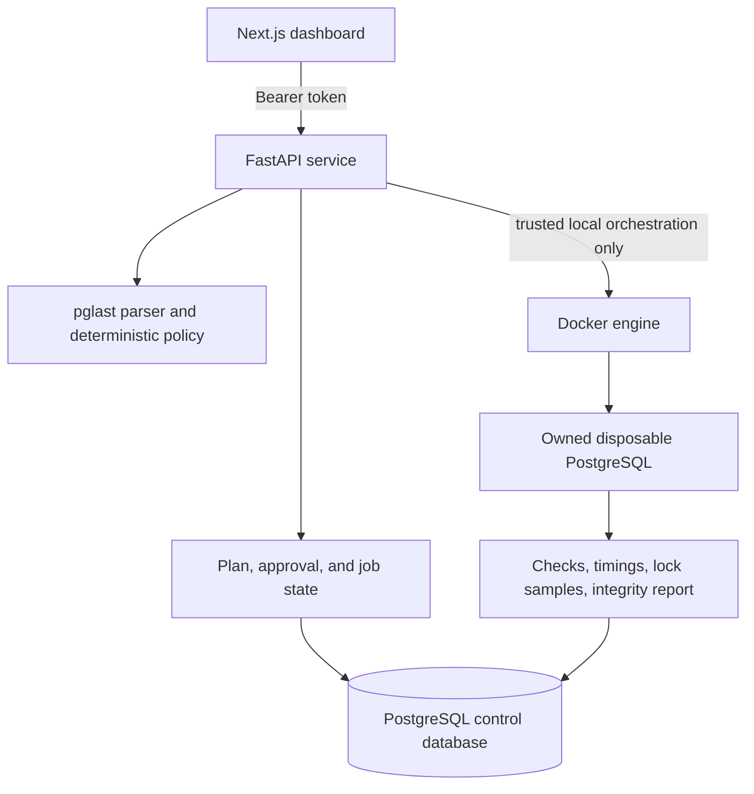

# SchemaShield

**Review PostgreSQL schema migrations, understand their risks, and validate eligible plans in disposable databases before a person approves execution.**

SchemaShield combines PostgreSQL AST parsing, deterministic policy checks, explainable scoring, staged plan generation, and an optional local execution harness. It keeps migration analysis separate from execution: a parsed statement is not automatically supported, a plan is not approval, and a passing fixture is not proof of production compatibility.

> SchemaShield is a local developer tool. It does not execute migrations against production or user-selected databases, guarantee zero downtime, or automatically reverse destructive SQL.

## At a glance

- **PostgreSQL-aware analysis:** parses SQL with `pglast`, reports source locations and diagnostics, and fails closed on unknown or unsupported syntax.
- **Explainable policy:** deterministic, versioned findings include severity, evidence, mitigations, and a 0–100 score where higher means safer. The score is not an authorization decision.
- **Reviewable alternatives:** generates staged plans for a limited set of changes, with preconditions, verification steps, transaction requirements, and explicit manual gates.
- **Disposable validation:** when enabled on a trusted local Docker engine, tests eligible hash-bound artifacts against owned, short-lived PostgreSQL fixtures with resource and time limits.
- **Human-controlled execution:** approval requires passing validation evidence for the same artifact; approval is single-use and expires with its evidence window.
- **Operator dashboard:** inspect analysis, plans, validation reports, lock metrics, backfill jobs, migration history, and audit events in one place.
- **Optional AI proposals:** an administrator-configured HTTPS gateway may suggest candidate SQL. Deterministic analysis remains authoritative; proposals cannot approve or execute.

## How a migration moves through the system



The analysis parser recognizes a deliberately limited PostgreSQL grammar. AST recognition does not imply that a statement is low risk or eligible for execution. The execution guard has a narrower allowlist than analysis and rejects unsupported operations before they reach a sandbox.

## What is and is not automated

| Area | Implemented behavior | Boundary |
| --- | --- | --- |
| SQL analysis | PostgreSQL 17 assumptions; multi-statement parsing; supported table, column, constraint, and index operations | No target catalog, application version, data distribution, dependency graph, or workload is inferred; unknown syntax fails closed |
| Risk and score | Versioned findings with source locations, evidence, and mitigations; deterministic 0–100 score | Static analysis is not runtime proof, approval, or a production safety estimate |
| Plan generation | Eligible changes can produce EXPAND, BACKFILL, VERIFY, and CONTRACT steps; includes timeouts and verification requirements | Destructive changes and unsupported transformations require independent manual design; cutover and contract work are not automatic |
| PostgreSQL validation | Owned, fresh, disposable PostgreSQL 17.11 environments with bounded CPU, memory, process count, statement time, and lock wait | A small fixture cannot establish production compatibility; DDL statements may commit individually, so failure is not rollback |
| Backfill demo | Resumable, bounded copy from `accounts.email` to `accounts.email_shadow` in the fixed fixture | Not a general mapping engine; application dual writes and cutover remain manual; progress lasts only as long as its disposable database |
| AI | Optional untrusted candidate proposal followed by deterministic reanalysis | No live provider success is claimed; AI has no policy, approval, or execution authority |

The planner can, for example, request `CREATE INDEX CONCURRENTLY` outside an explicit transaction and stage supported CHECK/foreign-key constraints with `NOT VALID` followed by validation. It can also describe replacement-column paths, but mapping, application dual writes, cutover, and contract gates need human work. No zero-downtime guarantee is made.

## Architecture



The control database stores migrations, plans, jobs, approvals, and audit records. The execution database is a separate, owned disposable environment. Submitted requests cannot supply a database URL, Docker image, Docker arguments, host path, or shell command. Only the trusted API receives Docker orchestration access; migration containers do not receive the Docker socket.

The main implementation areas are:

- `backend/schemashield/parser.py`, `policy.py`, `scoring.py`, and `planner.py`: AST extraction, versioned rules, score calculation, and staged alternatives.
- `backend/schemashield/main.py`, `store.py`, and `contracts.py`: authenticated API, persistence, job lifecycle, approval checks, and audit records.
- `backend/schemashield/sandbox.py`, `execution_guard.py`, and `backfill.py`: local disposable PostgreSQL, narrow execution allowlist, and fixed-fixture recovery demo.
- `frontend/`: Next.js dashboard, API client, and Playwright browser workflows.
- `alembic/`: control-database schema migrations.
- `scripts/`: local/full verification, container checks, evaluation, demo, and SHA-256 checkpoints.

## Quick start

### Requirements

- Python 3.12 or later and [uv](https://docs.astral.sh/uv/)
- Node.js 20.9 or later and npm
- Docker Compose with a trusted local Docker engine for disposable validation and execution

The PostgreSQL control store and disposable execution environments have separate purposes. Base Compose keeps sandbox execution disabled, so analysis can run without Docker access from the API. Enabling the sandbox mounts the Docker socket into trusted orchestration code; use that option only on a Docker engine you control.

### Install dependencies

```sh
uv sync --frozen --extra dev
npm ci --prefix frontend
```

Copy `.env.example` to `.env` (`Copy-Item .env.example .env` in PowerShell, or `cp .env.example .env` in POSIX shells). Before enabling the sandbox, set private values for `CONTROL_DB_PASSWORD` and `SCHEMASHIELD_API_TOKEN`. Sandbox execution rejects the shipped development API token. Do not commit `.env` or certificates.

### Start the dashboard and API

For analysis without disposable runtime validation:

```sh
docker compose up --build -d --wait
```

For the complete local workflow, first pull the pinned image and opt into the sandbox overlay:

```sh
docker pull postgres:17.11-bookworm
docker compose -f compose.yaml -f compose.sandbox.yaml up --build -d --wait
```

Open the dashboard at [http://localhost:3000](http://localhost:3000). The API health and readiness endpoints are `/health` and `/ready`; interactive API documentation is at [http://localhost:8000/docs](http://localhost:8000/docs). Enter the configured API token in the dashboard connection settings. The browser keeps it in page memory and does not write it to browser storage.

To stop services while preserving migration history:

```sh
docker compose -f compose.yaml -f compose.sandbox.yaml down
```

Do not add `--volumes` unless you intend to delete the control database and its history.

## Dashboard workflow

1. Submit SQL and inspect the deterministic decision, findings, source locations, rule versions, assumptions, and score deductions.
2. Generate a plan when the input is eligible. Review each SQL step, precondition, transaction mode, verification, warning, and manual handoff.
3. Validate the original artifact or plan in a fresh disposable PostgreSQL environment. Inspect the actual checks and report before proceeding.
4. Enter a reviewer name to approve the matching artifact hash and passing report. Approval evidence is single-use and valid for one hour.
5. Execute only with that approval. The execution uses another disposable database and reports integrity checks and audit evidence.
6. Use the separate History, Backfill & jobs, and Audit trail views to inspect saved work, cancel active jobs, and review events.

The demo is intentionally constrained. See [the complete reproducible workflow](docs/DEMO.md) for concrete SQL examples, expected gates, and troubleshooting.

## Configuration and security

Settings use the `SCHEMASHIELD_` environment prefix; Compose also defines `CONTROL_DB_PASSWORD`. The supplied `.env.example` shows the local values. Notable settings include:

| Setting | Purpose |
| --- | --- |
| `SCHEMASHIELD_DATABASE_URL` | Control-database connection; PostgreSQL is required for service use; SQLite is test/development only |
| `SCHEMASHIELD_API_TOKEN` | Bearer token required by API write and data routes; replace the shipped value before sandbox use |
| `SCHEMASHIELD_CORS_ORIGIN` | Dashboard origin allowed by the API |
| `SCHEMASHIELD_SANDBOX_ENABLED` | Enables validation/execution against owned disposable PostgreSQL environments; disabled by default |
| `SCHEMASHIELD_SANDBOX_TRANSPORT` | Local connection mode (`loopback` or container-network mode for supported deployments) |
| `SCHEMASHIELD_AI_GATEWAY_URL` / `SCHEMASHIELD_AI_GATEWAY_TOKEN` | Optional administrator-configured HTTPS proposal gateway |

Operational boundaries:

- Never point migration execution at the control database, production, or a user-selected database URL.
- Do not expose the Docker socket, API, or dashboard to untrusted users. The API is trusted orchestration code.
- One API worker may own a control database; a PostgreSQL advisory lease rejects a competing or lease-lost worker.
- SQL, comments, paths, and AI output are untrusted. Unknown parser nodes, invalid artifacts, stale hashes, and incomplete evidence fail closed.
- Only a named human approval of a matching, tested artifact can authorize the narrow local execution path. AI cannot approve, execute, or override policy.
- A failed disposable run may have committed earlier DDL statements. SchemaShield disposes of the environment and reports the failure; it does not claim automatic rollback or reverse destructive changes.
- Keep credentials, certificates, and private keys out of logs, source control, and Docker build contexts.

## Verification and evidence

Run the local static and unit gates:

```sh
uv run python scripts/verify.py
```

Run the full gates, which require real Docker/PostgreSQL integration and browser execution:

```sh
uv run python scripts/verify.py --full
```

The latest recorded local report, [reports/verification.json](reports/verification.json), is dated 2026-10-13 and passed all 8 local gates, including 267 unit tests with zero skips or failures, Python and frontend lint/format checks, frontend production build, static evaluation, and npm audit. It does not establish live PostgreSQL, browser, or Compose behavior.

The most recent full gate attempt could not pass Docker capability detection because the local Docker service was unavailable; integration, browser, runtime, and Compose gates were not run in that session. The earlier full run on 2026-10-12 passed 14 gates with 266 unit tests, 18 real PostgreSQL integration tests, 7 Chromium workflows, and Compose deployment/cleanup. That is historical evidence for the then-verified source revision, not a full rerun of the current source. See [STATE.md](STATE.md) and [evaluation methods and limitations](docs/EVALUATION.md) for exact status and evidence.

The checked-in evaluation uses a small, hand-labeled development corpus (24 cases, repeated 50 times) and fixed PostgreSQL fixtures. Neither these results nor short controlled workloads are production safety or reliability estimates. Reports disclose sample sizes, conditions, failures, and measurement limits.

## Project map

| Path | Purpose |
| --- | --- |
| `backend/schemashield/` | API, parser, deterministic policy, scoring, plans, persistence, approval, and sandbox |
| `frontend/` | Next.js dashboard and Playwright browser workflows |
| `alembic/` | Control-database schema migrations |
| `fixtures/` | Small labeled policy-evaluation dataset |
| `tests/` | Unit, security-boundary, and real PostgreSQL integration tests |
| `scripts/verify.py` | Local and full verification entry point |
| `compose.yaml` / `compose.sandbox.yaml` | Local services and opt-in Docker sandbox |
| `docs/DEMO.md` | Reproducible end-to-end walkthrough and troubleshooting |
| `docs/EVALUATION.md` / `reports/` | Evaluation methods and recorded reports |
| `ARCHITECTURE.md` / `DECISIONS.md` | System contracts, trust boundaries, and technical decisions |

## Further reading

- [Reproduce the demo](docs/DEMO.md)
- [Evaluation results and limitations](docs/EVALUATION.md)
- [Architecture and trust boundaries](ARCHITECTURE.md)
- [Technical decisions](DECISIONS.md)
